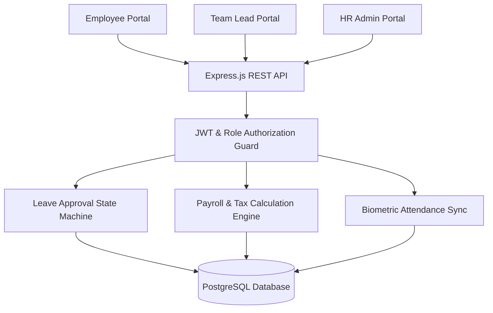

# WorkSuite-HRMS — Enterprise Workforce Governance & Payroll Management Platform

[](https://react.dev/)
[](https://nodejs.org/)
[](https://www.postgresql.org/)
[](LICENSE.md)

**WorkSuite-HRMS** is a scalable human resource management system tailored for growing enterprises. It orchestrates employee onboarding, multi-tier leave approval hierarchies, automated tax and payroll calculation, biometric attendance logging, and performance appraisal tracking in an intuitive, role-segregated portal.

---

## Problem Statement & Context
SMEs face significant administrative friction utilizing manual human resource workflows:
- **Disorganized Leave Tracking**: Conflicting vacation requests and manual email approvals lead to understaffing during critical project deadlines.
- **Payroll Inaccuracies**: Manual spreadsheet calculations of overtime, tax deductions (TDS), and provident funds result in payroll errors.
- **Compliance Deficits**: Failure to maintain immutable audit logs of attendance and wage disbursements exposes organizations to legal liability.

---

## Existing Solutions & Critical Gaps
| Existing Method | Administrative Overhead | Error Probability | Compliance Auditability |
| :--- | :--- | :--- | :--- |
| **Excel Spreadsheets** | High (>30 hrs/month) | Very High | Zero audit trail |
| **Expensive SaaS HRMS** | Low | Low | High, but prohibitive cost for growing teams |
| **WorkSuite-HRMS** | **Minimal (<3 hrs/month)** | **Zero (Automated formula engine)** | **Full cryptographic audit trail** |

---

## Proposed Solution & Architectural Innovation
WorkSuite-HRMS establishes an **Automated Workforce Operating System**:
- **Dynamic Multi-Tier Leave Hierarchy**: Routes leave requests to immediate team leads and department heads with automatic calendar sync.
- **Automated Payroll Engine**: Computes gross salaries, standardized tax deductions, bonuses, and net pay in one batch operation.
- **Role-Based Portals**: Distinct dashboards for HR Executives, Department Managers, and Individual Employees.
- **Encrypted Document Vault**: Secure Cloudinary/S3 integration for employee tax forms, ID verifications, and performance contracts.

---

## Technical Approach & System Architecture


---

## Quantifiable Impact & Measurable Benefits
- **85% Reduction in Payroll Processing Time**: Monthly payroll finalized in under 30 minutes.
- **100% Elimination of Calculation Discrepancies**: Automated formulas ensure mathematically precise tax and wage allocations.
- **Self-Service Transparency**: Employees view payslips, leave balances, and company policies directly.

---

## Feasibility, Operational Viability & Scalability
- **Deployability**: Containerized Docker Compose deployment ready for on-premise or cloud hosting.

---

## Project Architecture & Quickstart
```bash
git clone https://github.com/Tharun4743/WorkSuite-HRMS.git
cd WorkSuite-HRMS
npm install
npm run dev
```

---

## Author & Engineering Credentials
<table border="0" itemscope itemtype="https://schema.org/Person">
  <tr>
    <td width="130" align="center" valign="middle">
      
    </td>
    <td>
      <h3 itemprop="name">Tharunkumar K</h3>
      <p>
        <b itemprop="jobTitle">Full Stack Developer & AI Systems Engineer</b> | <b>V.S.B. Engineering College (VSBEC)</b><br/>
        🎓 <b>B.Tech in Information Technology</b> — <b>V.S.B. Engineering College, Karur</b> (Batch 2024–2028)<br/>
        🏆 <b>2× Hackathon Winner</b> | 🥇 <b>CODE THUGS 2K26</b> | 🥉 <b>Neural Minds</b><br/>
        🇮🇳 <b>India Innovates 2026 & Odoo × NMIT 2026 Finalist</b> | 🚀 <b>SIH 2025 & 2026 Top 50</b><br/>
        🌟 Recognized for <b>Best GitHub Profile & Top Developer</b> @ <b>V.S.B. ENGINEERING COLLEGE</b>
      </p>
      <p>
        🚀 <b>Top Flagship Engineering Projects:</b><br/>
        • 🏛️ <b>TaskManager (VSBEC IT Vault)</b> — Institutional Task Governance & LeetCode/GitHub Sync &nbsp;<a href="https://github.com/Tharun4743/Taskmanager"></a>&nbsp;<a href="https://it-taskmanager.vercel.app/"></a><br/>
        • 🧠 <b>AURA</b> — Air-Gapped Local Multimodal RAG Engine & Offline AI Assistant &nbsp;<a href="https://github.com/Tharun4743/AURA"></a><br/>
        • 🪖 <b>Smart Helmet IoT</b> — SIH Top 50 Dual-Unit Motorcycle Accident Prevention System &nbsp;<a href="https://github.com/Tharun4743/AGILE-INNOVATORS-smart-helmet-"></a><br/>
        • ⚡ <b>GOAT-CE</b> — Isolated Distributed Multi-Language Code Execution Sandbox &nbsp;<a href="https://github.com/Tharun4743/GOAT-CE"></a>
      </p>
      <p>
        <a href="https://tharunkumark4743.netlify.app/"></a>&nbsp;
        <a href="https://github.com/Tharun4743"></a>&nbsp;
        <a href="https://www.linkedin.com/in/tharunkumark4743"></a>&nbsp;
        <a href="https://leetcode.com/u/Tharunkumar__K/"></a>&nbsp;
        <a href="mailto:tharunkumark42007@gmail.com"></a>
      </p>
    </td>
  </tr>
</table>
