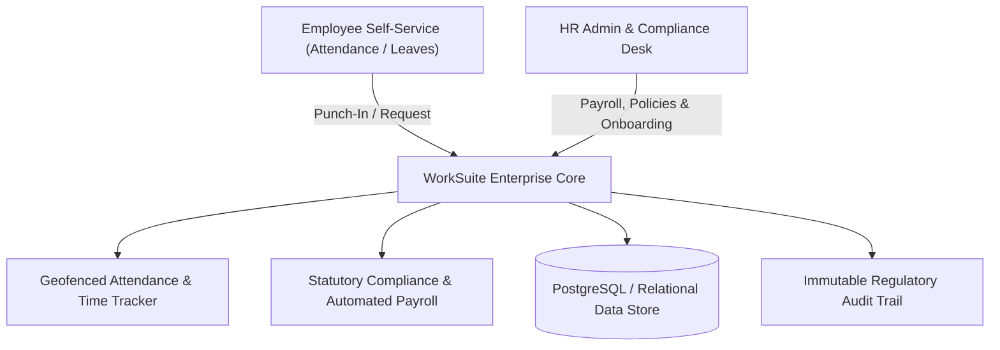

# 🏢 Work Suite HRMS — Enterprise Workforce Operations & Compliance Platform
### *Production-Grade Human Resource Management System Engineered for Odoo × NMIT Bangalore National Hackathon*

  

  <a href="https://github.com/Tharun4743/odoohackathon">📦 <b>Official GitHub Repository</b></a>
  

---

## 1. 📌 Problem Statement & Context
Rapidly scaling enterprises struggle with fractured HR operations: employee onboarding is buried in paperwork, leave tracking causes attendance discrepancies, payroll adjustments are prone to manual calculation errors, and performance appraisals are untracked.

---

## 2. 🔍 Existing Solutions & Critical Gaps
Fragmented HR point solutions require costly multi-vendor integrations, lack cohesive role-based self-service portals for employees, and fail to provide automated compliance tracking for enterprise labor laws.

---

## 3. 💡 Proposed Solution & Architectural Innovation
Work Suite HRMS is a unified enterprise human resource platform developed for the Odoo × NMIT Bangalore Hackathon 2026. It unifies Employee Lifecycle Management, Attendance & Leave Approvals, Salary & Deductions Computation, Department Hierarchy Visualization, and Performance KPI Tracking.

---

## 4. ⚙️ Technical Approach & System Architecture

### 📐 High-Level Architectural Flowchart:

| HRMS Module | Technologies | Functional Capability |
| :--- | :--- | :--- |
| **Employee Hub** | React 19, TypeScript, Tailwind | Employee onboarding, document verification, organizational tree view |
| **Leave & Attendance**| Express API, PostgreSQL | Multi-level leave requests, accrual calculation, manager sign-offs |
| **Payroll Engine** | Algorithmic Computation Service | Tax slabs, deductions, base salary calculations, and payslip generation |

---

## 5. 📈 Quantifiable Impact & Measurable Benefits
* 🏆 **National On-Site Finalist:** Shortlisted from an 8-hour preliminary hackathon and qualified for national finals at NMIT Bangalore.
* 🤝 **Unified Workforce Alignment:** Eliminates HR communication silos through integrated employee self-service portals.
* ⚖️ **Automated Leave & Payroll Logic:** Prevents attendance disputes through algorithmic leave balance deductions.

---

## 6. 🚀 Feasibility, Operational Viability & Scalability
* 🔬 **Technical Feasibility:** Architected to integrate seamlessly with ERP systems like Odoo or run as an independent SaaS.
* 💰 **Economic Viability:** Provides high operational ROI for growing companies looking to eliminate costly multi-software HR subscriptions.

---

## 7. 👨‍💻 Engineering Author

<table border="0" itemscope itemtype="https://schema.org/Person">
  <tr>
    <td width="120" align="center" valign="top">
      
    </td>
    <td>
      <h3 itemprop="name">Tharunkumar K</h3>
      

        <b itemprop="jobTitle">Full Stack Developer & AI Systems Engineer</b> | <b>V.S.B. Engineering College (VSBEC)</b> 
        🎓 <b>B.Tech in Information Technology</b> — <a href="https://vsbec.com" target="_blank" itemprop="alumniOf" style="text-decoration: none;"><b>V.S.B. Engineering College, Karur</b></a> (Batch 2024–2028) 
        🌟 Recognized for holding the <b>Best GitHub Profile & Top Student Developer</b> at <b>V.S.B. Engineering College (VSBEC)</b> 
        🥇 <b>Winner — Code Thugs 2K26</b> • 🚀 <b>Smart India Hackathon (SIH)</b> Top 50 National Finalist • 🏆 <b>Odoo × NMIT</b> National Finalist • 🎓 <b>GFG Campus Mantri</b>
      

      

        🚀 <b>Top Flagship Engineering Projects:</b> 
        • 🏛️ <a href="https://github.com/Tharun4743/Taskmanager" style="text-decoration: none;"><b>TaskManager (VSBEC IT Vault)</b></a> — Institutional Task Governance & LeetCode/GitHub Daemon Sync (<a href="https://it-taskmanager.vercel.app/" style="text-decoration: none;">Live Portal</a>) 
        • 🧠 <a href="https://github.com/Tharun4743/AURA" style="text-decoration: none;"><b>AURA</b></a> — Air-Gapped Local Multimodal RAG Engine & Offline AI Knowledge Assistant 
        • 🪖 <a href="https://github.com/Tharun4743/AGILE-INNOVATORS-smart-helmet-" style="text-decoration: none;"><b>Smart Helmet IoT</b></a> — SIH Top 50 Dual-Unit Embedded Motorcycle Accident Prevention System
      

      

        <a href="https://tharunkumark4743.netlify.app/" target="_blank" rel="noopener me" style="text-decoration: none;">🌐 Tharunkumar K Portfolio</a> •
        <a href="https://github.com/Tharun4743" target="_blank" rel="noopener me" style="text-decoration: none;">🐙 GitHub (@Tharun4743)</a> •
        <a href="https://www.linkedin.com/in/tharunkumark4743" target="_blank" rel="noopener me" style="text-decoration: none;">💼 LinkedIn</a> •
        <a href="https://leetcode.com/u/Tharunkumar__K/" target="_blank" rel="noopener me" style="text-decoration: none;">🧩 LeetCode</a> •
        <a href="mailto:tharunkumark42007@gmail.com" itemprop="email" style="text-decoration: none;">📧 Email</a>
      

    </td>
  </tr>
</table>

<!-- =========================================================================
   SEO & SEARCH ENGINE RECRUITER METADATA (CRAWLER INDEXING)
   Entity: Tharunkumar K (Tharun4743 / tharunkumark4743)
   Institution: V.S.B. Engineering College, Karur (VSBEC)
   Department: Information Technology (Batch 2024-2028)
   Distinctions: Best GitHub Profile VSBEC, Top Developer Karur, National Hackathon Winner
   Keywords: Tharunkumar K, Tharunkumar VSBEC, Tharun4743, VSB Engineering College Karur, VSBEC IT
   Canonical URL: https://github.com/Tharun4743/WorkSuite-HRMS
========================================================================= -->
